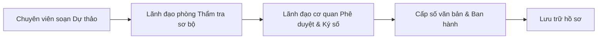

# HỆ THỐNG THÔNG TIN QUẢN LÝ HÀNH CHÍNH & VĂN BẢN ĐIỀU HÀNH (E-OFFICE)

> **Hệ thống Quản lý Văn bản, Điều hành tác nghiệp và Hồ sơ lưu trữ điện tử theo chuẩn Nghị định 30/2020/NĐ-CP**

---

## 📌 1. Giới thiệu dự án (Project Overview)

Dự án **Quản lý hành chính (E-Office)** là giải pháp phần mềm quản lý văn bản và điều hành tác nghiệp dành cho cơ quan nhà nước, đơn vị sự nghiệp công lập và doanh nghiệp. Hệ thống số hóa toàn bộ vòng đời văn bản (Văn bản đến, Văn bản đi, Dự thảo, Tờ trình), hỗ trợ bút phê chỉ đạo, phân công xử lý, luân chuyển văn bản, ký số, đóng dấu phát hành, lưu trữ hồ sơ công việc và theo dõi tiến độ theo thời gian thực.

---

## 🛠️ 2. Công nghệ sử dụng (Tech Stack)

| Thành phần | Công nghệ / Thư viện | Ghi chú |
| :--- | :--- | :--- |
| **Framework** | **Next.js 16 (App Router)** | Server Components, Route Handlers, Turbopack |
| **Frontend UI** | **React 19**, **Tailwind CSS v4** | Giao diện hiện đại phong cách Enterprise, Dark/Light mode |
| **Icons & UI Kits**| **Lucide React**, **Sonner** | Bộ icon đồng bộ, toast notifications |
| **Form & Validate**| **React Hook Form**, **Zod** | Validation 2 chiều (Client & Server schemas) |
| **State & Data** | **TanStack Query (React Query v5)**, **TanStack Table v8** | Quản lý cache và bảng dữ liệu chuyên sâu |
| **Database & ORM** | **PostgreSQL**, **Prisma ORM v6** | Migration, relational queries, full-text search |
| **Local Dev DB** | **Embedded Postgres (macOS / Windows / Linux)** | Chạy CSDL PostgreSQL cục bộ mà không cần cài thêm DB server |
| **Bảo mật & Auth** | **Jose (JWT)**, **bcryptjs** | HttpOnly Cookie Session, Role-Based Access Control (RBAC) |

---

## 👥 3. Tài khoản đăng nhập & Phân quyền (Roles & Accounts)

Hệ thống được thiết kế tinh gọn và chuẩn hóa với **4 vai trò (Roles)** cốt lõi:

| Vai trò (Role) | Chức danh / Đơn vị | Email đăng nhập | Mã NV | Mật khẩu mặc định | Thẩm quyền & Nghiệp vụ |
| :--- | :--- | :--- | :--- | :--- | :--- |
| **ADMIN** | Quản trị viên hệ thống | `admin@eoffice.local` | `ADMIN001` | **`Admin@123`** | Quản trị người dùng, cơ cấu phòng ban, phân quyền vai trò, cấu hình sổ văn bản, xem Audit Log an toàn |
| **LEADER** | Lãnh đạo Cơ quan | `giamdoc@eoffice.local` | `GD001` | **`Demo@123`** | Cho ý kiến chỉ đạo bút phê văn bản đến, phê duyệt và ký số văn bản đi toàn cơ quan |
| **LEADER** | Lãnh đạo Phòng TCHC | `truongphong.tchc@eoffice.local`<br>*(alias: `lanhdao.tchc@eoffice.local`)* | `TP001` | **`Demo@123`** | Duyệt sơ bộ văn bản, phân công thụ lý cho chuyên viên phòng TCHC |
| **LEADER** | Lãnh đạo Phòng KHTC | `lanhdao.khtc@eoffice.local` | `LD002` | **`Demo@123`** | Duyệt sơ bộ văn bản, phân công thụ lý phòng Kế hoạch - Tài chính |
| **LEADER** | Lãnh đạo Phòng NV1 | `lanhdao.nv1@eoffice.local` | `LD003` | **`Demo@123`** | Duyệt sơ bộ văn bản, phân công thụ lý phòng Nghiệp vụ 1 |
| **SPECIALIST** | Chuyên viên 1 - Phòng TCHC | `chuyenvien.tchc@eoffice.local` | `CV001` | **`Demo@123`** | Tiếp nhận văn bản đến, vào sổ, thụ lý văn bản, soạn thảo dự thảo văn bản đi |
| **SPECIALIST** | Chuyên viên 2 - Phòng TCHC | `chuyenvien2.tchc@eoffice.local` | `CV002` | **`Demo@123`** | Thụ lý văn bản đến, phối hợp xử lý, soạn thảo dự thảo (ngang cấp CV001) |
| **SPECIALIST** | Chuyên viên - Phòng KHTC | `chuyenvien.khtc@eoffice.local` | `CV003` | **`Demo@123`** | Thụ lý văn bản, soạn thảo dự thảo thuộc phòng KHTC |
| **SPECIALIST** | Chuyên viên - Phòng NV1 | `chuyenvien.nv1@eoffice.local` | `CV004` | **`Demo@123`** | Thụ lý văn bản, soạn thảo dự thảo thuộc phòng Nghiệp vụ 1 |
| **CITIZEN** | Người dân / Doanh nghiệp | `nguoidan@eoffice.local` | `CD001` | **`Demo@123`** | Nộp hồ sơ / văn bản trực tuyến qua cổng dịch vụ công, theo dõi tiến độ giải quyết |

---

## 🔄 4. Quy trình nghiệp vụ cốt lõi (Core Workflows)

### 📥 A. Luồng Văn bản Đến (Incoming Workflow)


1. **Tiếp nhận & Vào sổ**: Người dân nộp đơn trực tuyến hoặc đơn vị gửi văn bản đến. Chuyên viên hoặc Lãnh đạo tiếp nhận, kiểm tra tính hợp lệ và vào sổ văn bản đến.
2. **Trình Lãnh đạo & Bút phê**: Trình văn bản lên Lãnh đạo phụ trách để xin ý kiến chỉ đạo, thời hạn giải quyết và đơn vị chủ trì.
3. **Phân công thụ lý**: Lãnh đạo phụ trách phân công chuyên viên chủ trì và chuyên viên phối hợp xử lý.
4. **Thụ lý & Báo cáo**: Chuyên viên thụ lý nghiên cứu hồ sơ, thực hiện nghiệp vụ và nộp báo cáo kết quả giải quyết.
5. **Duyệt hoàn thành & Lưu hồ sơ**: Lãnh đạo kiểm tra kết quả báo cáo, phê duyệt kết thúc và chuyển hồ sơ vào lưu trữ điện tử.

---

### 📤 B. Luồng Văn bản Đi (Outgoing Workflow)


1. **Soạn thảo dự thảo**: Chuyên viên soạn thảo tờ trình / dự thảo văn bản đi và đính kèm các tài liệu liên quan.
2. **Thẩm tra sơ bộ**: Lãnh đạo phụ trách đơn vị kiểm tra thể thức, nội dung dự thảo (Chấp thuận hoặc Yêu cầu hiệu chỉnh).
3. **Phê duyệt & Ký số**: Lãnh đạo cơ quan xem xét, ký duyệt điện tử văn bản.
4. **Cấp số & Ban hành**: Chuyên viên / Lãnh đạo phụ trách cấp số hiệu chính thức theo sổ văn bản đi và phát hành văn bản.
5. **Lưu trữ hồ sơ**: Hệ thống tự động đóng gói văn bản vào hồ sơ công việc lưu trữ.

---

## 📁 5. Cấu trúc thư mục (Project Structure)

```
eoffice/
├── prisma/
│   ├── schema.prisma       # Toàn bộ schema cơ sở dữ liệu (Units, Users, Documents, Handlers, Approvals...)
│   └── seed.ts             # Dữ liệu khởi tạo (Phòng ban, Chức danh, Roles, Permissions, Tài khoản)
├── src/
│   ├── app/
│   │   ├── (dashboard)/    # Các phân hệ Dashboard theo vai trò
│   │   │   ├── admin/      # Quản trị (Users, Units, Positions, Roles, Books, Audit Logs)
│   │   │   ├── documents/  # Quản lý Văn bản đến, Văn bản đi, Chi tiết văn bản [id]
│   │   │   ├── citizen/    # Cổng nộp văn bản trực tuyến (Dịch vụ công)
│   │   │   ├── catalogs/   # Sổ văn bản
│   │   │   ├── archives/   # Hồ sơ công việc & lưu trữ
│   │   │   ├── tasks/      # Bàn làm việc (Việc của tôi)
│   │   │   └── reports/    # Báo cáo thống kê
│   │   ├── api/            # API Route Handlers (Auth, Documents, Admin, Citizen...)
│   │   └── login/          # Trang đăng nhập Quản lý hành chính
│   ├── components/         # UI Components dùng chung (Sidebar, Header, DataTable, Dialogs...)
│   ├── modules/            # Business Logic & Validation Schema (auth, document, catalog)
│   └── lib/                # Database prisma client, auth session, state machine, demo data
├── public/                 # Static assets
├── docs/                   # Tài liệu hướng dẫn quy trình và kiểm thử
├── tests/                  # Bộ kịch bản kiểm thử tự động (4 roles, 2 luồng, CRUD, workflows)
├── .env.example            # Mẫu cấu hình biến môi trường
└── package.json            # Scripts & Dependencies
```

---

## 🚀 6. Hướng dẫn cài đặt & Khởi chạy (Getting Started)

### Bước 1: Cài đặt Dependencies
```bash
npm install
```

### Bước 2: Thiết lập biến môi trường
Sao chép `.env.example` thành `.env`:
```bash
cp .env.example .env
```
*(Nếu sử dụng Embedded Postgres đi kèm dự án, cấu hình mặc định sẵn sàng hoạt động)*.

### Bước 3: Khởi tạo CSDL & Seed dữ liệu mẫu
```bash
npx prisma db push
npm run db:seed
```

### Bước 4: Chạy môi trường phát triển (Development)
```bash
npm run dev
```
Hệ thống sẽ chạy tại địa chỉ: `http://localhost:3001` (hoặc `http://localhost:3000`).

---

## 🧪 7. Kiểm thử hệ thống (Automated Tests)

Chạy các bộ kiểm thử tự động để xác nhận tính toàn vẹn của 4 vai trò và quy trình nghiệp vụ:

```bash
# 1. Kiểm tra 4 vai trò và 2 luồng văn bản đến / văn bản đi
node tests/test-4roles-2flows.mjs

# 2. Kiểm tra CRUD và phân quyền tài khoản cho Chuyên viên, Lãnh đạo, Quản trị viên
node tests/test-crud-roles.mjs

# 3. Kiểm tra toàn diện luồng văn bản đến và thẩm quyền
node --env-file=.env tests/incoming-workflow.mjs

# 4. Kiểm tra ký số, bảo mật tệp gốc, cấp số và ban hành
node --env-file=.env tests/other-modules.mjs
```

---

## 🔒 8. Bảo mật & Tiêu chuẩn tuân thủ
- **Nghị định 30/2020/NĐ-CP**: Quy định về công tác văn thư, định dạng thể thức số ký hiệu văn bản (`{number}/{typeCode}-{unitCode}`).
- **RBAC (Role-Based Access Control)**: Phân quyền ma trận giữa Vai trò, Quyền hạn (Permissions) và Phạm vi dữ liệu (DataScope: `ALL`, `UNIT_TREE`, `UNIT`, `OWN`).
- **Audit Logs**: Ghi vết mọi hành động nghiệp vụ quan trọng (đăng nhập, tiếp nhận, chuyển trạng thái, ký duyệt, sửa/xóa).

---

## 📖 9. Quy trình chi tiết

Xem thêm [Quy trình và kiểm thử cục bộ](docs/quy-trinh-va-kiem-thu.md) để biết chi tiết luân chuyển hồ sơ, xử lý báo cáo phối hợp và các trường hợp trả lại.
