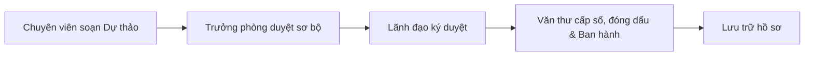

# HỆ THỐNG THÔNG TIN QUẢN LÝ HÀNH CHÍNH & VĂN BẢN ĐIỀU HÀNH (E-OFFICE)

> **Hệ thống Quản lý Văn bản, Điều hành tác nghiệp và Hồ sơ lưu trữ điện tử theo chuẩn Nghị định 30/2020/NĐ-CP**

---

## 📌 1. Giới thiệu dự án (Project Overview)

Dự án **Quản lý hành chính (E-Office)** là giải pháp phần mềm quản lý văn bản và điều hành tác nghiệp dành cho cơ quan nhà nước, đơn vị sự nghiệp công lập và doanh nghiệp. Hệ thống số hóa toàn bộ vòng đời văn bản (Văn bản đến, Văn bản đi, Dự thảo, Tờ trình), hỗ trợ bút phê, phân công xử lý, luân chuyển văn bản, ký số, đóng dấu phát hành, lưu trữ hồ sơ công việc và theo dõi tiến độ theo thời gian thực.

---

## 🛠️ 2. Công nghệ sử dụng (Tech Stack)

| Thành phần | Công nghệ / Thư viện | Ghi chú |
| :--- | :--- | :--- |
| **Framework** | **Next.js 16 (App Router)** | Server Components, Route Handlers, Turbopack |
| **Frontend UI** | **React 19**, **Tailwind CSS v4** | Giao diện hiện đại phong cách Enterprise, Dark/Light mode |
| **Icons & UI Kits**| **Lucide React**, **Sonner** | Bộ icon đồng bộ, toast notifications |
| **Form & Validate**| **React Hook Form**, **Zod** | Validation 2 chiều (Client & Server schemas) |
| **State & Data** | **TanStack Query (React Query v5)**, **TanStack Table v8** | Quản lý cache và bảng dữ liệu chuyên sâu |
| **Database & ORM** | **PostgreSQL**, **Prisma ORM v6** | Migration, relational queries, full-text search |
| **Local Dev DB** | **Embedded Postgres (macOS / Windows / Linux)** | Chạy CSDL PostgreSQL cục bộ mà không cần cài thêm DB server |
| **Bảo mật & Auth** | **Jose (JWT)**, **bcryptjs** | HttpOnly Cookie Session, Role-Based Access Control (RBAC) |

---

## 👥 3. Tài khoản đăng nhập & Phân quyền (Roles & Accounts)

Hệ thống hỗ trợ 6 vai trò chính theo chuẩn quy trình hành chính công:

| Vai trò (Role) | Chức danh / Tên | Email đăng nhập | Mã NV | Mật khẩu mặc định | Thẩm quyền & Nghiệp vụ |
| :--- | :--- | :--- | :--- | :--- | :--- |
| **ADMIN** | Quản trị viên hệ thống | `admin@eoffice.local` | `ADMIN001` | **`Admin@123`** | Quản trị người dùng, cơ cấu phòng ban, phân quyền vai trò, cấu hình sổ văn bản, xem Audit Log an toàn |
| **LEADER** | Giám đốc (Nguyễn Văn An) | `giamdoc@eoffice.local` | `GD001` | **`Demo@123`** | Cho ý kiến chỉ đạo bút phê văn bản đến, phê duyệt và ký duyệt văn bản đi |
| **DEPT_HEAD** | Trưởng phòng (Trần Thị Bình) | `truongphong.tchc@eoffice.local` | `TP001` | **`Demo@123`** | Duyệt sơ bộ văn bản, phân công thụ lý cho chuyên viên, theo dõi tiến độ |
| **CLERK** | Văn thư (Lê Văn Cường) | `vanthu@eoffice.local` | `VT001` | **`Demo@123`** | Tiếp nhận văn bản đến, vào sổ, cấp số đến/đi, phát hành văn bản |
| **SPECIALIST** | Chuyên viên (Phạm Thị Dung) | `chuyenvien.tchc@eoffice.local` | `CV001` | **`Demo@123`** | Thụ lý văn bản đến, báo cáo tiến độ, soạn dự thảo văn bản đi |
| **CITIZEN** | Người dân / Doanh nghiệp | `nguoidan@eoffice.local` | `CD001` | **`Demo@123`** | Nộp hồ sơ / văn bản trực tuyến qua cổng dịch vụ công |

---

## 🔄 4. Quy trình nghiệp vụ cốt lõi (Core Workflows)

### 📥 A. Luồng Văn bản Đến (Incoming Workflow)


### 📤 B. Luồng Văn bản Đi (Outgoing Workflow)


---

## 📁 5. Cấu trúc thư mục (Project Structure)

```
eoffice/
├── prisma/
│   ├── schema.prisma       # Toàn bộ schema cơ sở dữ liệu (Units, Users, Documents, Handlers, Approvals...)
│   └── seed.ts             # Dữ liệu khởi tạo (Phòng ban, Chức danh, Roles, Permissions, Tài khoản)
├── src/
│   ├── app/
│   │   ├── (dashboard)/    # Các phân hệ Dashboard theo vai trò
│   │   │   ├── admin/      # Quản trị (Users, Units, Positions, Roles, Books, Audit Logs)
│   │   │   ├── documents/  # Quản lý Văn bản đến, Văn bản đi, Chi tiết văn bản [id]
│   │   │   ├── citizen/    # Cổng nộp văn bản trực tuyến (Dịch vụ công)
│   │   │   ├── catalogs/   # Sổ văn bản
│   │   │   ├── archives/   # Hồ sơ công việc & lưu trữ
│   │   │   ├── tasks/      # Bàn làm việc (Việc của tôi)
│   │   │   └── reports/    # Báo cáo thống kê
│   │   ├── api/            # API Route Handlers (Auth, Documents, Admin, Citizen...)
│   │   └── login/          # Trang đăng nhập Quản lý hành chính
│   ├── components/         # UI Components dùng chung (Sidebar, Header, DataTable, Dialogs...)
│   ├── modules/            # Business Logic & Validation Schema (auth, document, catalog)
│   └── lib/                # Database prisma client, auth session, state machine, demo data
├── public/                 # Static assets
├── .env.example            # Mẫu cấu hình biến môi trường
└── package.json            # Scripts & Dependencies
```

---

## 🚀 6. Hướng dẫn cài đặt & Khởi chạy (Getting Started)

### Bước 1: Cài đặt Dependencies
```bash
npm install
```

### Bước 2: Thiết lập biến môi trường
Sao chép `.env.example` thành `.env`:
```bash
cp .env.example .env
```
*(Nếu sử dụng Embedded Postgres đi kèm dự án, cấu hình mặc định sẵn sàng hoạt động)*.

### Bước 3: Khởi tạo CSDL & Seed dữ liệu mẫu
```bash
npx prisma db push
npm run db:seed
```

### Bước 4: Chạy môi trường phát triển (Development)
```bash
npm run dev
```
Hệ thống sẽ chạy tại địa chỉ: `http://localhost:3001` (hoặc `http://localhost:3000`).

---

## 🔒 7. Bảo mật & Tiêu chuẩn tuân thủ
- **Nghị định 30/2020/NĐ-CP**: Quy định về công tác văn thư, định dạng thể thức số ký hiệu văn bản (`{number}/{typeCode}-{unitCode}`).
- **RBAC (Role-Based Access Control)**: Phân quyền ma trận giữa Vai trò, Quyền hạn (Permissions) và Phạm vi dữ liệu (DataScope: `ALL`, `UNIT_TREE`, `UNIT`, `OWN`).
- **Audit Logs**: Ghi vết mọi hành động nghiệp vụ quan trọng (đăng nhập, tiếp nhận, chuyển trạng thái, ký duyệt, sửa/xóa).

## Quy trình theo vai trò và kiểm thử

Xem [Quy trình và kiểm thử cục bộ](docs/quy-trinh-va-kiem-thu.md) để biết người nhận ở từng bước, cách xử lý hồ sơ cũ thiếu dữ liệu, giới hạn phê duyệt điện tử và lệnh kiểm thử.
